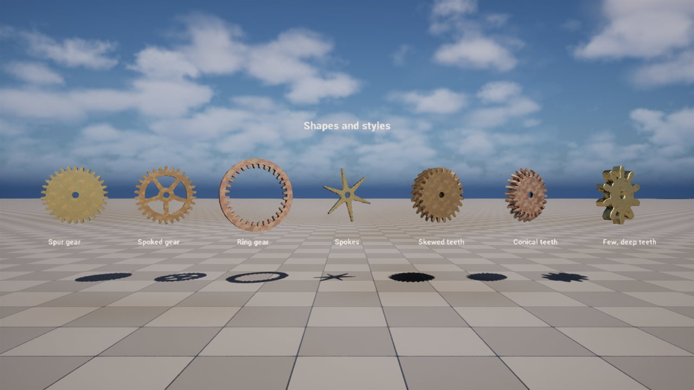
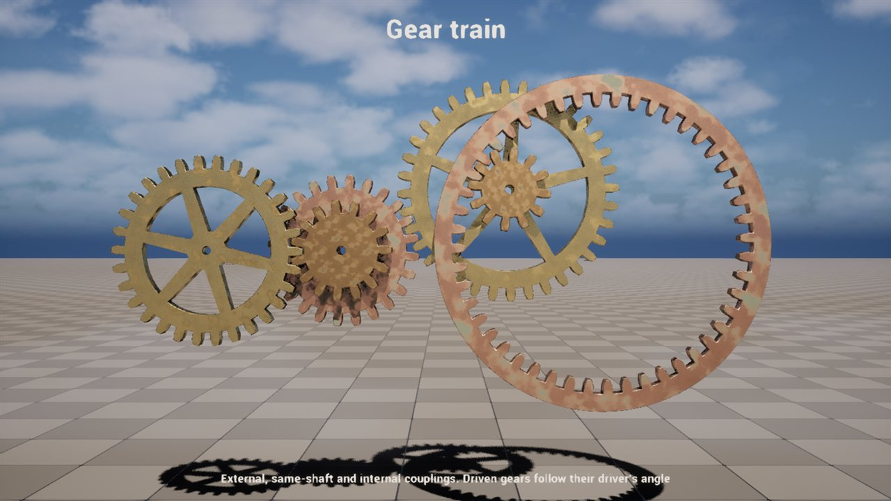
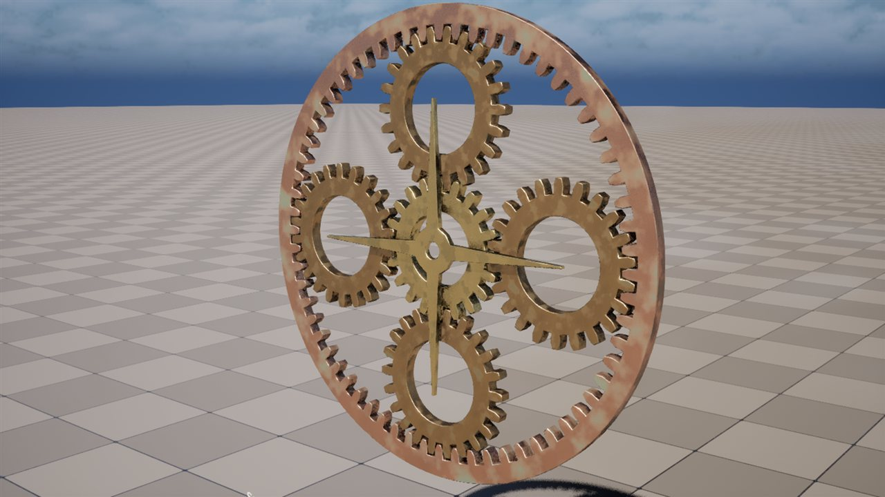

# Gear Generator user guide

Gear Generator makes gears procedurally in Unreal Engine 5.6 to 5.8. This guide covers placing and shaping gears,
linking them into trains, planetary gear sets, attaching things to gears, baking for shipping, the settings, the
Blueprint and C++ API, the included material, and the Showcase map.

Distances are in Unreal units (centimetres) and angles in degrees.

## Contents

- [Getting started](#getting-started)
- [Gear shapes](#gear-shapes)
- [Making gears mesh](#making-gears-mesh)
- [Gear trains](#gear-trains)
- [Planetary gear sets](#planetary-gear-sets)
- [Attaching things to gears](#attaching-things-to-gears)
- [Baking](#baking)
- [Project settings](#project-settings)
- [Blueprint and C++](#blueprint-and-c)
- [The gear material](#the-gear-material)
- [The Showcase map](#the-showcase-map)
- [Platforms](#platforms)
- [Limitations](#limitations)
- [Troubleshooting](#troubleshooting)
- [Support](#support)
- [Version history](#version-history)

## Getting started

1. Copy the `GearGenerator` folder into your project's `Plugins` folder, or install it from Fab. Enable
   **Gear Generator** in **Edit > Plugins** and restart the editor. It enables **Geometry Script**, which it uses
   to build meshes.
2. Place a **Gear Actor** from the **Gear Generator** category of the **Place Actors** panel, which also has the
   **Planetary Gear Actor**. To give an existing actor or Blueprint a gear, add a **Gear** component instead;
   everything below applies to both.
3. Select it and set the shape in the Details panel's **Gear** section. The gear regenerates as you edit.

A gear's own rotation is never changed while it turns: it is drawn by an internal mesh component that turns inside
it. Place and rotate the gear actor freely; to turn something with the gear, attach it to the gear's socket (see
[Attaching things to gears](#attaching-things-to-gears)).

## Gear shapes

**Type** chooses the shape:

| Type | What it makes |
|---|---|
| **Gear** | A spur gear with a hole in the middle |
| **Ring Gear** | An internal gear: teeth on the inside of a ring. Gears turn inside it |
| **Spoked Gear** | A gear rim joined to a hub by spokes |
| **Spokes** | A hub and spokes with no teeth, e.g. a carrier arm or a wheel |

### Gear options

These apply to Gear, Ring Gear and Spoked Gear.

| Setting | Meaning |
|---|---|
| **Radius** | Pitch radius: where the teeth of two meshing gears touch. For a ring gear, the radius of its teeth's pitch circle |
| **Number Of Teeth** | 1 to 4096 |
| **Thickness** | Depth of the gear along its axis |
| **Addendum** | How far the teeth reach beyond the pitch radius |
| **Dedendum** | How far the gaps between teeth go inside the pitch radius |
| **Base** | Width of solid material inside the tooth roots: to the hole for a gear, to the outer edge for a ring gear, to the spokes for a spoked gear. With conical teeth, this is its width on the near face |
| **Pressure Angle** | Slope of the tooth flanks, 0 to 60. 20 is standard |
| **Skew Angle** | Twists the teeth along the thickness, like a helical gear |
| **Conical Angle** | Tapers the teeth towards the far face, like a bevel gear, while the hole (or a ring gear's outer edge) stays straight. -80 to 80 |
| **Bevel** | Rounds the edges of the faces |

For gears to mesh, the teeth need a common size, the **module**: pitch diameter divided by number of teeth
(`2 × Radius / Number Of Teeth`). Standard proportions are **Addendum = module** and **Dedendum = 1.25 × module**.
With a module of 4, a 20-tooth gear has a radius of 40.

Sizes are measured on the gear's near face, its -Z side. Conical Angle narrows the teeth towards the far, +Z face, so
the rim between the tooth roots and the hole gets thinner by `Thickness × tan(Conical Angle)` there; a negative angle
widens the teeth instead.

**Half Tooth Rotation** turns the teeth by half a tooth, which sometimes lines a gear up with a neighbour by eye. It's
ignored for driven gears, whose teeth are lined up with their driver automatically.

### Spoke options

These apply to Spokes and Spoked Gear.

| Setting | Meaning |
|---|---|
| **Hub Radius** | Radius of the hole at the centre of the hub |
| **Radius** | Outer radius of the hub, where the spokes start |
| **Thickness** | Depth of the hub and spokes |
| **Spoke Count** | Number of spokes |
| **Spoke Width** | Width of each spoke where it meets the hub |
| **Spoke Length** | Length of each spoke, measured out from the hub. For a spoked gear, **Auto Spoke Length** sizes the spokes to reach the rim instead |
| **Spoke Taper** | Angle each side of a spoke leans inward; negative values flare outward |
| **Bevel** | Rounds the edges |

### When a shape can't be generated

If the settings can't make a valid shape, for example a hole with a negative radius, the gear shows a **Problems**
line in the Details panel saying which setting to change, and Map Check lists it as an error. The usual causes:

- **"Radius - Dedendum - Base must be greater than zero"**: the teeth and base leave no room for the hole. Reduce
  Base or Dedendum, or increase Radius.
- **"Base is too small for this ConicalAngle"**: the cone thins the rim towards the far face until it vanishes.
  Increase Base, or reduce Conical Angle or Thickness.
- **"the teeth's tips are too narrow for this many teeth"**: the tooth sides would cross at the tips, usually because
  Addendum is large for the tooth count. Use standard proportions (Addendum = module), or reduce Pressure Angle.
- **"SpokeWidth is too large"**: neighbouring spokes would overlap at the hub. Narrow them or use fewer.
- **"SpokeTaper is too large"**: the spokes taper to nothing before their full length.

## Making gears mesh

Two gears mesh when:

- their axes are parallel (they face the same way or opposite ways);
- they have the same module, to within 1%;
- their centres are the right distance apart, to within a tenth of the module: the sum of their radii for two
  ordinary gears, or the ring's radius minus the pinion's for a gear inside a ring gear;
- they overlap along their axes, so the teeth can touch;
- if their teeth are skewed, the skews match: Skew Angle twists a gear's far face, so a meshing gear needs a skew
  scaled by the tooth ratio (and thickness), the opposite way for two ordinary gears and the same way for a gear inside
  a ring gear. The link check tells you the value to use.

Gears on the same shaft (a compound gear) share an axis and can sit at any depth along it.

You don't need to line the teeth up. Once gears are linked in a train, each driven gear is turned so its teeth fall
into its driver's gaps.

## Gear trains

A gear train is a driver and the gears it turns. Every gear has a **Gear Train** section in the Details panel.

### Drivers

A gear with nothing in **Driven By** is a driver.

| Setting | Meaning |
|---|---|
| **Rotation Speed** | Revolutions per minute. Positive turns clockwise as seen from the gear's +Z side. 0 holds the train still |
| **Preview In Editor** | Turn the driver, and everything it drives, in the editor viewport |
| **Phase Offset** | Extra rotation, in degrees |

### Driven gears

| Setting | Meaning |
|---|---|
| **Driven By** | The gear that turns this one. Pick a gear on this or another actor; picking just an actor uses its root component |
| **Coupling** | How it connects to its driver (below) |
| **Phase Offset** | Extra rotation on top of the automatic phase. Leave at 0 unless you want the teeth deliberately out of line |

| Coupling | Use it for | It turns |
|---|---|---|
| **External** | Two ordinary gears with touching teeth | The opposite way, at driver teeth / driven teeth |
| **Internal** | A gear inside a ring gear, either driving the other | The same way, at driver teeth / driven teeth |
| **Same Shaft** | Gears fixed to one axle, including spokes | Exactly with its driver |

A driven gear's angle is always worked out from its driver's, never accumulated, so long trains never drift out of
mesh. If a gear faces the opposite way to its driver, it turns the other way about its own axis, as a real one would.

### Linking gears automatically

Select the gears and use **Tools > Gear Generator > Link Meshing Gears**, or the same entry on the right-click menu.
Starting from the selected gears that have a Rotation Speed (or the first selected gear), it follows every pair that
is placed to mesh, and sets Driven By and Coupling: External for touching gears, Internal for a gear in a ring gear,
and Same Shaft for gears on one axle. It reports any selected gears it couldn't reach; check their positions and
modules.

### Checking links

Each driven gear checks its link as you edit. A problem appears in the gear's **Problems** line, prefixed
"Gear train:", and in Map Check. The checks are:

| Message | Fix |
|---|---|
| its axis isn't parallel to its driver's | Rotate one gear so they face the same or opposite ways |
| it isn't on its driver's axle | For Same Shaft, move it onto the driver's axis |
| its module differs from its driver's | Change Radius or Number Of Teeth so the modules match |
| it is X from its driver's centre but should be Y to mesh | Move it to the distance shown |
| it doesn't overlap its driver along their axes | Move it along its axis until the teeth overlap |
| its Skew Angle is X but should be Y | Set its Skew Angle to the value shown |
| a ring gear meshes on the inside; use Internal coupling | Change Coupling to Internal |
| Internal coupling needs one ring gear and one ordinary gear | Use External, or make one of them a ring gear |
| spokes have no teeth to mesh with; use Same Shaft coupling | Spokes can only share a shaft |
| planet gears move around the carrier, so they can't drive other gears | Drive from the planetary set's sun or ring instead |
| Driven By doesn't name another gear | Pick the driver again; it may have been deleted |
| it is driven by a loop of Driven By links | Break the loop: one gear in it must be a driver |

A gear with a link problem still turns with its driver at the right ratio; only the meshing is wrong.

## Planetary gear sets

Place a **Planetary Gear Actor** for a sun gear, planets on a carrier and a ring gear, all meshing.

| Setting | Meaning |
|---|---|
| **Sun Gear Teeth**, **Planet Gear Teeth** | The ring's teeth follow: sun + 2 × planet |
| **Number Of Planets** | 1 to 32. They're spaced as evenly as their teeth allow |
| **Module** | Tooth size, shared by every gear in the set |
| **Input Gear** | The member that's driven: Sun, Carrier or Ring |
| **Fixed Gear** | The member held still |
| **Rotation Speed** | Speed of the input in revolutions per minute |
| **Rotate** | Turn the set while playing |
| **Preview In Editor** | Turn the set in the editor viewport |
| **Thickness**, **Addendum**, **Dedendum**, **Base**, **Pressure Angle**, **Bevel** | As for gears |
| **Skew Angle** | Skew of the sun's teeth. The planets and ring are skewed to match automatically |
| **Sun / Planet / Ring Gear Material** | Materials for each member |

The other members turn at the speeds given by the planetary gear equation. **Get Speeds** returns them, and
**Solve Speeds** works them out for any tooth counts.

Ordinary gears can be driven by the set's **sun** or **ring** gear, like any other gear: set their Driven By to the
SunGear or RingGear component. Planets can't drive other gears, because they travel round the carrier.

## Attaching things to gears

Only a gear's internal mesh turns, so anything attached to the gear in the usual way stays still. That's useful for
brackets and housings. To make something turn with a gear, attach it to a socket:

- **Gears** have a **Gear** socket that follows the teeth.
- **Planetary gear sets** have **Sun**, **Ring** and **Carrier** sockets, and **Planet1** up to the number of planets.
  A thing on a planet socket spins with the planet and travels round with the carrier.

In a level, attach an actor to the gear (or planetary set) and choose the socket in the attached actor's
**Parent Socket** field. In a Blueprint, attach a component to the gear component and set its **Parent Socket**. In
C++, attach with `UGearComponent::GearSocketName`, or the names on `UPlanetaryGearRootComponent`.

Attached things must have their **Mobility** set to **Movable**, or Unreal won't move them.

The socket follows the teeth exactly, like a mark painted on the gear. If you move or relink a gear, its teeth are
re-phased to mesh with the new driver, and anything on its socket turns with them; set attached things' angles last.

## Baking

A gear generates its mesh when it's created. That's convenient while you edit, but costs time when a level loads,
so for shipping, gears should be **baked**: saved as static mesh assets that load like any other.

- **Tools > Gear Generator > Bake All Gears in Level** bakes every gear that isn't baked or is out of date.
- **Bake Selected Gears**, the right-click **Bake Gears** entry, and the **Bake** button in a gear's Details panel
  bake just those gears.
- **Rebuild Baked Gear Meshes in Level** rebuilds the existing meshes, e.g. after changing the collision or Nanite
  settings.
- **Delete Unused Baked Gear Meshes** finds baked meshes in the bake folder that no saved asset or open level uses,
  lists them and deletes them once you confirm. Only meshes with baked-mesh names are considered; other assets in
  the folder are left alone.

Baked meshes are named after their shape, such as `SM_Gear_24T_0123456789ABCDEF`. Gears that differ only in size
share one mesh, scaled to fit. When you change a gear's shape, it generates again until you rebake; the old mesh stays
until you delete it.

Baked meshes have lightmap UVs, the collision chosen in the [project settings](#project-settings), and Nanite if
enabled. The **Collision Profile** on each gear sets how its mesh collides.

### Unbaked gears at runtime

An unbaked or out-of-date gear still works in a game: it generates its mesh when it loads and logs a warning once per
shape, *"gear mesh generated at runtime"*. Generated meshes have no collision shapes. Map Check lists unbaked gears
with a **Bake** button, and saving a level warns about them (see **On Save Behaviour**).

Dedicated servers and other builds without rendering never generate meshes. Gear trains still turn there, so game
logic based on gear angles works.

## Project settings

**Edit > Project Settings > Plugins > Gear Generator**:

| Setting | Meaning |
|---|---|
| **Generated Asset Path** | Folder for baked meshes. Default `/Game/GearGenerator/Meshes` |
| **On Save Behaviour** | When a level is saved with unbaked gears: **Warn** lists them in the message log, **Auto Bake** bakes them, **Off** does nothing |
| **Baked Collision** | **Simple**: a cylinder at the tooth roots, or a ring of segments for ring gears; never blocks neighbouring teeth. **Use Complex As Simple**: the gear's own triangles; exact but more expensive, and not usable for simulated physics. **None** |
| **Baked Nanite** | **Use Project Setting** follows the project's Nanite setting; or **Enabled** or **Disabled** |

Collision and Nanite apply to meshes baked afterwards. Use **Rebuild Baked Gear Meshes in Level** to update existing
ones.

## Blueprint and C++

### Gear component

| Function | Use |
|---|---|
| **Get Shape** / **Set Shape** | Read or change the whole shape |
| **Set Material**, **Set Half Tooth Rotation** | Appearance |
| **Get Number Of Teeth**, **Get Module** | Tooth count (or spoke count), and module |
| **Get Problems** | Generation problems as text; empty when the shape is valid |
| **Update Mesh** | Regenerate or re-apply the mesh now |
| **Get Mesh ETag**, **Is Baked Mesh Current** | The shape's mesh identifier, and whether the baked mesh matches it |
| **Get Rotation Speed** / **Set Rotation Speed** | A driver's speed in RPM |
| **Set Drive Angle** | Turn a driver to an angle; everything it drives follows. Works in BeginPlay |
| **Get Gear Angle** | How far the gear has turned about its own axis |
| **Get Driver**, **Set Driven By**, **Get Coupling** | Read or change links at runtime |
| **Get Train Driver** | The gear at the top of this gear's train, whose speed and drive angle turn it. Itself if nothing drives it |

For example, to start a clock at the current time, call **Set Drive Angle** on its seconds driver in BeginPlay with
`((Hour % 12) × 3600 + Minute × 60 + Second) × 6`. The Showcase's Level Blueprint does exactly this.

To let a player crank a mechanism by grabbing any of its gears, call **Get Train Driver** on the gear they grabbed and
**Set Rotation Speed** or **Set Drive Angle** on the result.

### Planetary gear actor

**Get Sun Gear**, **Get Ring Gear**, **Get Planet Gears** and **Get Carrier** return the members. **Get Speeds**,
**Solve Speeds**, **Get Planet Placement**, **Get Ring Gear Teeth** and **Get Pitch Radius** do the maths.

### Geometry Script

For your own dynamic meshes, the **Gear Generator** Geometry Script category has **Append Gear**, **Append Ring
Gear**, **Append Spokes** and **Append Gear Shape**, plus **Create ETag**, which identifies a shape's mesh. They work
in Blueprints and Editor Utility Widgets like any other Geometry Script function.

### C++

Add `GearGenerator` to your module's dependencies. The main classes are `UGearComponent`, `AGearActor`,
`APlanetaryGearActor` and `UGearTrainSubsystem` (a world subsystem that turns every train). `UGearComponent::OnMeshUpdated()`
is broadcast after a gear's mesh changes.

## The gear material

The plugin's gears use **M_Gear** (`/GearGenerator/Material`), an aged-metal material with these instances:
**MI_MetalBrass**, **MI_MetalBronze**, **MI_MetalCopper**, **MI_MetalSteel** and **MI_MetalBluedSteel**. Make your
own instance of M_Gear to change any of these parameters:

| Parameter | Meaning |
|---|---|
| **Base Color**, **Metallic**, **Roughness** | The clean surface |
| **Tarnish** | How much of the surface is tarnished, 0 to 1 |
| **Tarnish Darken** | Colour multiplier in tarnished patches |
| **Tarnish Roughness** | Extra roughness in tarnished patches |
| **Patina** | Tints tarnished patches with **Patina Color** and makes them less metallic, for copper and bronze |
| **Variation** | Broad colour variation across the surface |
| **Grain** | Streaks, for wood |
| **Noise Tiling** | How many times the noise repeats across a gear |
| **Noise** | The noise texture: red for fine speckle, green for broad patches, blue for streaks |

The noise uses the mesh's UVs, which are laid out evenly across a gear's faces and walls, so the pattern turns with
the gear. Any material works on gears; set it with the gear's **Material** setting.

## The Showcase map

Open **/GearGenerator/Maps/Showcase**. In the Content Browser, enable **Settings > Show Plugin Content** to see the
plugin's folders. It has:

- **Skeleton clock**: an eight-gear train turns the seconds, minute and hour hands, which are attached to Gear
  sockets. The Level Blueprint starts it at the current time; it then runs at 60 times normal speed. Set the seconds pinion's
  Rotation Speed to 1 for real time.
- **Planetary gear set**: the sun drives and the ring is fixed. A spokes-only arm on the Carrier socket turns with the
  carrier.
- **Gear train**: external, same-shaft and internal couplings.
- **Shapes and styles**: one of each shape and style.

Each station has a camera, and Play starts in front of the clock with a free-flying camera.

## Platforms

The plugin is built and tested for **Win64** and **Android**. The runtime has no platform-specific code, so for other
platforms (Linux, including dedicated servers, Mac or iOS), add the platform to the **PlatformAllowList** of the
`GearGenerator` module in `GearGenerator.uplugin` and build the plugin from source. The editor module is for Windows.

## Limitations

- **Moving or relinking a gear re-phases its teeth.** Anything on its socket turns with them, so set attached things'
  angles after the gears are in place.
- **Deleting a driver's actor quietly unlinks the gears it drove.** Their Driven By empties, so they become drivers
  with no speed and stop, with no warning. Pick a new driver for them.
- **Generated (unbaked) meshes have no collision.** Bake gears that need collision.
- **Gear teeth are for looks.** Gears don't push each other physically; trains are turned by the gear train
  subsystem.

## Troubleshooting

**A gear is invisible.** Check its **Problems** line: the shape may be invalid. Also check the gear's **Visible** and
**Hidden In Game** settings, which apply to its mesh.

**Two gears clash or turn the wrong way.** Make sure the driven gear's Coupling matches how they meet, and look for a
Gear train problem in its Problems line or Map Check.

**Something attached to a gear doesn't turn.** Attach it to the **Gear** socket (not just the gear), and set its
Mobility to Movable.

**"gear mesh generated at runtime" in the log.** A gear wasn't baked, or its shape changed after baking. Use **Bake
All Gears in Level** and save.

**A baked gear looks wrong after updating the plugin.** Use **Rebuild Baked Gear Meshes in Level**.

## Support

Report bugs and ask questions on the [issue tracker](https://github.com/TechnoMyth/gear-generator/issues). Please include your Unreal Engine version and, for
a gear that won't generate or mesh, its **Problems** line. The latest version of this guide is at
[docs.technomyth.com/gear-generator/](https://docs.technomyth.com/gear-generator/).

## Version history

**1.0**: first release.
