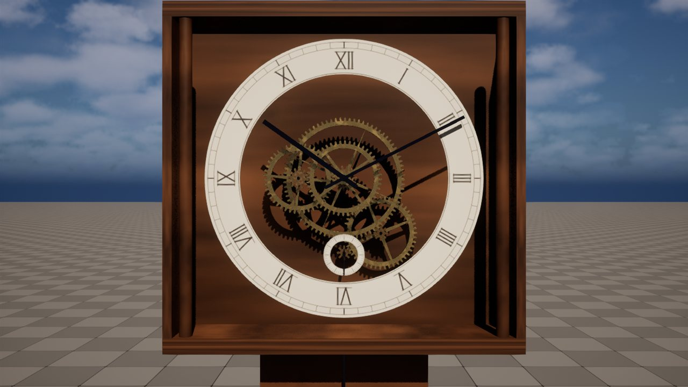

# Gear Generator

Procedural gears for game engines. Set a gear's teeth and size and it is generated on the spot: spur gears, ring
gears, spoked gears and spokes, with skewed and conical teeth. Link gears into trains that turn at the right ratios
with their teeth always interlocking, build planetary gear sets, attach things that turn with any gear, and bake
everything to meshes for shipping.

## Choose your engine

- **[Unreal Engine](unreal/index.md)**: the Gear Generator plugin for Unreal Engine 5.6, 5.7 and 5.8, on Win64 and
  Android.
- **Unity**: in development.

## Support

Report bugs and ask questions on the [issue tracker](https://github.com/TechnoMyth/gear-generator/issues). Please say
which engine and version you use.
